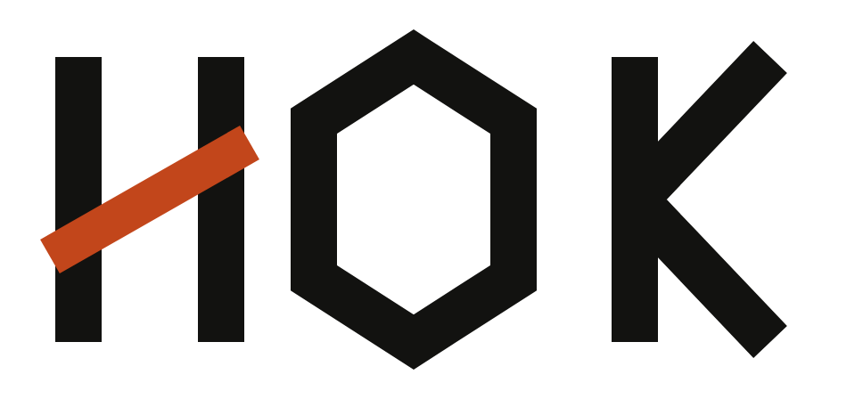

<div align="center">

<picture>
  <source media="(prefers-color-scheme: dark)" srcset="assets/brand/hok-wordmark-light.png" />
  
</picture>

# HOK Mobile

**Run your shop's day from your pocket.**

The mobile app that staff, supervisors and managers use to run a shop's business day: what must be done, what came in, and what went wrong. A shop is called a *hok* in the app. This is the `tapt-mobile` repo of the TAPT platform.

<a href="docs/media/tapt-demo.mp4">
  
</a>

<sub>Click for the full-quality video. Source in [`video/`](video) (Remotion).</sub>

</div>

## Features

- **Today list**: one checklist per business day, made of due items (forms, deliveries, tasks, tickets).
- **Deliveries**: check deliveries in as they arrive, with suppliers and categories.
- **Work**: assign tasks, raise and follow tickets, and see who is on shift.
- **Money**: till, expenses, and day close with the numbers right.
- **Scratch cards**: receive packs, track games and pack sales.
- **Role-aware**: staff, supervisors and the manager tier each get the tabs and actions that fit them.
- **Team**: staff pages, invites, devices and account settings.

## Tech stack

Expo 58 and React Native 0.88, Expo Router, TanStack Query, socket.io client, TypeScript. Talks to the NestJS API in [`../tapt-api`](../tapt-api) and shares its `packages/api` contracts.

## Getting started

```bash
yarn install
yarn start
```

Run on a device or emulator:

```bash
yarn android
yarn ios
```

Lint:

```bash
yarn lint
```

The app needs the API from `../tapt-api` running. `EXPO_PUBLIC_APP_ENV` (read in `app.config.js`) selects the environment.

## Project layout

| Path | What lives there |
|---|---|
| `app/` | Expo Router routes (auth, tenant, per-shop tabs and detail screens) |
| `src/features/` | Feature modules: auth, shops, work, money, deliveries, scratch, forms |
| `src/components/` | Shared UI (buttons, sheets, toasts, tab bar) |
| `src/theme/` | Colors, typography, shared styles |
| `docs/` | ADRs, knowledge base, agent config, demo video plan |
| `GLOSSARY.md` | The shared vocabulary (Today list, due item, business day...) |

## Documentation

- [`GLOSSARY.md`](GLOSSARY.md): domain language
- [`docs/adr/`](docs/adr): architecture decisions
- [`docs/knowledge/`](docs/knowledge): work log, lessons, reference
- [`docs/reference/video/PLAN.md`](docs/reference/video/PLAN.md): demo video plan
- [`video/`](video): demo video source. Re-render with `cd video && npm install && npm run render && npm run render:gif`
